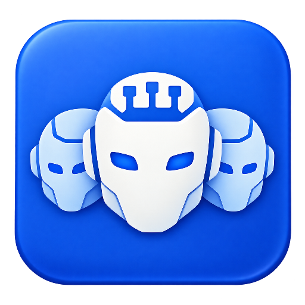
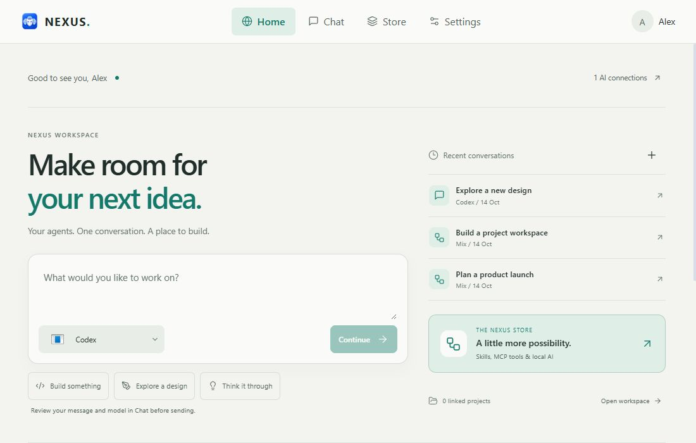
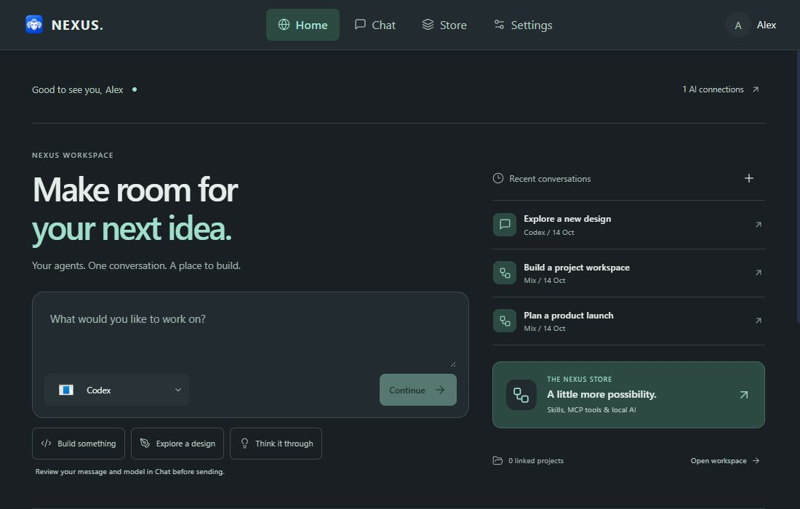
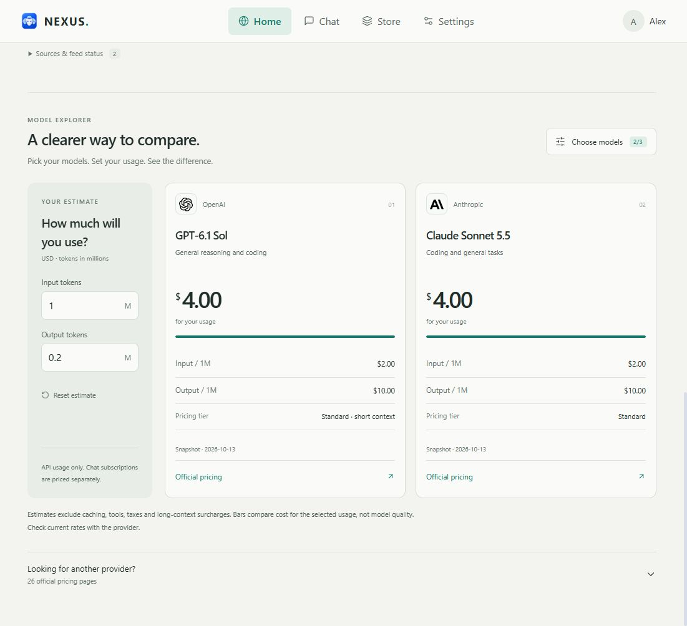
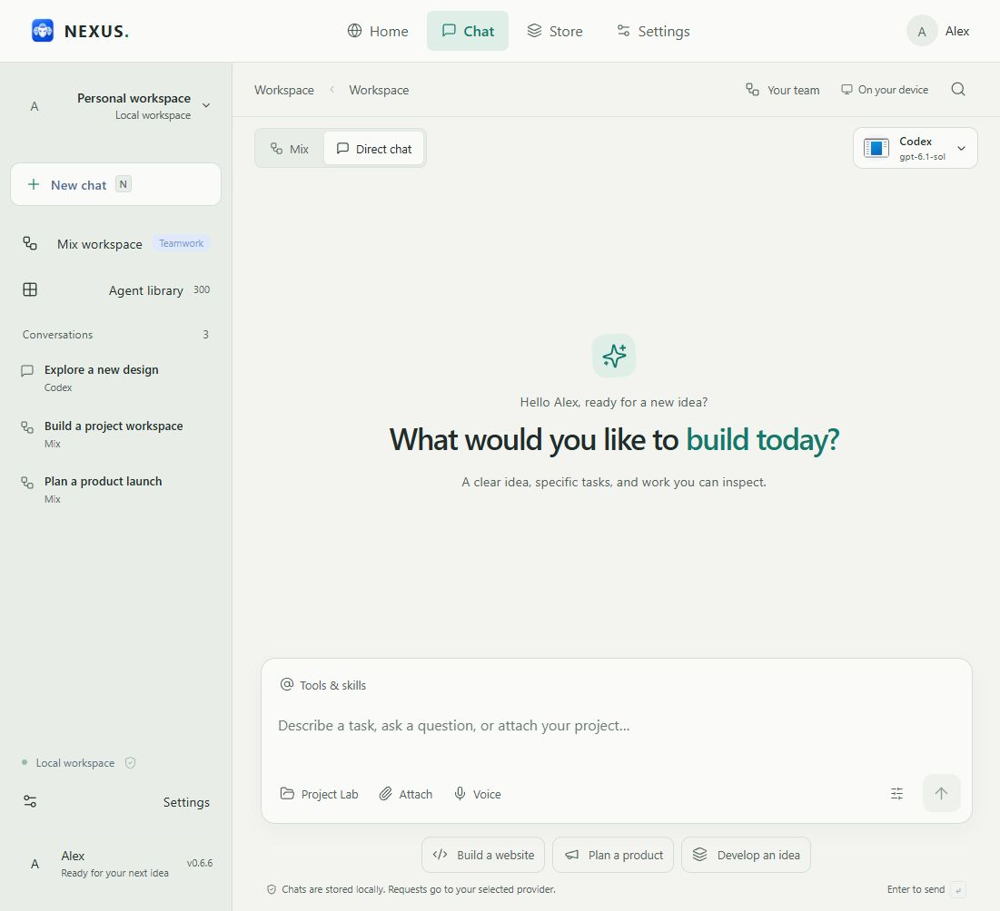
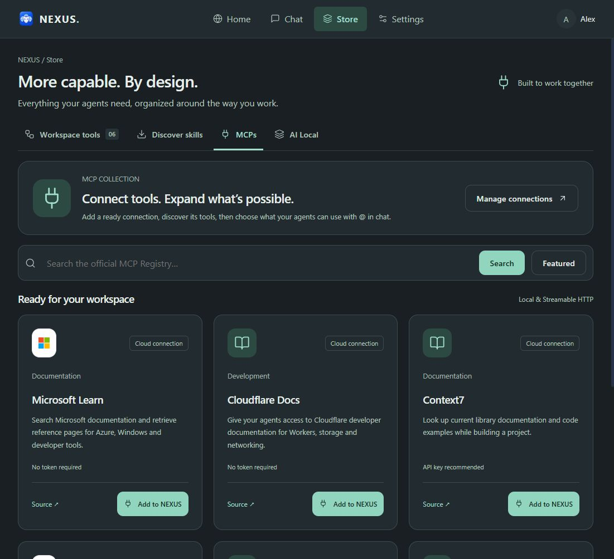

  
  <h1>NEXUS</h1>
  <h3>Make room for your next idea.</h3>
  
Your AI tools, conversations and specialist team in one Windows workspace.

  
<strong><a href="https://github.com/Ahmed-Khalil-Mohamed/NEXUS/releases/download/v0.6.6/NEXUS-Setup-0.6.6.exe">Download for Windows</a></strong> · <a href="https://github.com/Ahmed-Khalil-Mohamed/NEXUS/releases/tag/v0.6.6">What's new in 0.6.6</a> · <a href="docs/USER-GUIDE.md">User guide</a>

  
Windows x64 · English & Arabic · Light & dark · Proprietary software

## New in 0.6.6

A new Home with a real conversation launcher, clearer model comparison cards, editorial AI news and a calmer visual system. This release also includes the Store, local-model downloads, richer connections and Mix inspection added since 0.5.1.

| Start with an idea | Choose your tools | Understand the work |
| --- | --- | --- |
| Draft from Home and continue in Chat. Resume recent conversations. | Select supported agents, local models or API connections. Extend them with skills and MCP tools. | Inspect Mix assignments, recorded instructions, tool events and reported usage. |

**[Read the full update and upgrade guide](docs/RELEASE-0.6.6.md)**

## Download & start

| Download | Best for |
| --- | --- |
| **[NEXUS-Setup-0.6.6.exe](https://github.com/Ahmed-Khalil-Mohamed/NEXUS/releases/download/v0.6.6/NEXUS-Setup-0.6.6.exe)** | Guided installation and Windows shortcuts. |
| [NEXUS-0.6.6-Windows.exe](https://github.com/Ahmed-Khalil-Mohamed/NEXUS/releases/download/v0.6.6/NEXUS-0.6.6-Windows.exe) | Running without installation; settings still live in your Windows profile. |
| [SHA256SUMS.txt](https://github.com/Ahmed-Khalil-Mohamed/NEXUS/releases/download/v0.6.6/SHA256SUMS.txt) | Verifying both EXE downloads. |

1. Close any older NEXUS version, then open the installer or portable EXE.
2. Wait for the startup banner. Enter your name once, choose AI news interests, discover tools and select supported connections.
3. Start a conversation, select a project folder, or assemble a Mix team.
4. Use Store for extensions and Settings for connections, language, appearance and preferences.

**Updating?** Back up `%APPDATA%/NEXUS/workspace` with NEXUS closed. See the [upgrade steps](docs/RELEASE-0.6.6.md#updating-from-an-earlier-version). Opening an older EXE will still show the older interface.

Node.js is bundled. A supported provider account or local model service is required; subscriptions, quotas and usage charges still apply. Current Windows x64 downloads are unsigned. Verify the download source and checksum without disabling Windows security. No ARM64, macOS or Linux package is provided.

GitHub automatically adds **Source code (zip / tar.gz)** archives. They contain this repository's documentation and images, **not NEXUS development source**. Download an **EXE** to use the program.

## A workspace that starts with your idea

Home brings a draft composer, recent conversations and workspace shortcuts together. Continue to Chat to review the selected connection and model before sending. Your interests shape the official AI announcements shown below.

## Compare models without the spreadsheet

Pick up to three models and adjust your estimated input/output token usage. Cards show snapshot prices, estimated API cost and official source links. The directory includes 26 providers' pricing pages.

Estimates use a dated snapshot, not live billing quotes. Bars compare cost, not quality. Check provider pricing for current rates, caching, tools, taxes and long-context charges. Chat subscriptions are separate.

## Your agents, local models and APIs

Start a direct conversation with supported CLI agents, local services or compatible API connections. Agent/model selection lives in the chat toolbar; the sidebar keeps your conversations together. Built-in execution adapters include Codex CLI, Claude Code CLI, Ollama and LM Studio, alongside compatible custom connectors.

Detection does not guarantee execution: an app needs a supported CLI/API and any required authentication. Model catalogs are supplied by the selected connection where available; cached/default choices are labeled. No subscriptions or model weights are bundled.

## Store: give your workspace more capability

| Section | What it does |
| --- | --- |
| **Workspace tools** | Project Lab, Mix, files/media, activity reports and the specialist library. |
| **Discover skills** | Browse supported catalogs, review a skill, choose a compatible detected agent and install its folder. |
| **MCPs** | Add ready integrations or search supported entries from the official MCP Registry. Discover tools and choose permissions. |
| **AI Local** | Browse Hugging Face GGUF models and download supported public single-file models through Ollama, then use installed models in Chat or Mix. |

Ready MCP connections include Microsoft Learn, Cloudflare Docs, Context7 and Hugging Face, plus bundled Knowledge Memory and folder-scoped Project Filesystem. Adding a server does not automatically grant tool permissions. MCP OAuth is not supported in this version.

Ollama must be installed for the local-model download flow. Model licenses, hardware requirements, architecture and tool support vary. Gated/private repositories and split GGUF downloads are excluded. See the [0.6.6 guide](docs/RELEASE-0.6.6.md) for boundaries.

## Mix: a team you can inspect

**Your brief → Manager plan → Specialist assignments → Integration → Review → Repair when needed → Final report**

NEXUS Manager coordinates a library of 300 editable roles spanning engineering, design, planning, marketing, security and more. Select supported agents, Local AI and API connections for the execution team. Inspect stages to see assigned tasks, recorded instructions, provider/model metadata, reported activity and outputs.

The 300 roles are instruction definitions, **not 300 bundled models**. Teams run in scheduled batches with up to four concurrent calls depending on configuration and memory. Larger teams require more requests and time. Recorded instructions are the prompts sent to providers, not private model reasoning.

Project Lab reads a selected folder within limits. Attach documents, code and supported images; video supplies sampled frames, and voice requires a configured transcription service. Review generated file changes before Apply. Conflict checks and local backups help protect existing work.

## Privacy & control

Settings, conversations and project records are stored locally. Sending a request shares relevant messages, selected project content and supported attachments with your chosen provider; its policies apply. Discovery enumerates paths and respects Windows permissions. It does not read every personal document. NEXUS does not automatically execute generated code or install project dependencies. [Privacy details](docs/PRIVACY.md).

## Verification & support

The 0.6.6 release passed **73 automated tests**, the production build and Windows unpacked/portable launch checks. UI verification covered the composer, comparison calculator, themes, Arabic RTL and narrow layouts. Live third-party inference was not retested for this visual release; test adapters do not establish real-provider quality.

[Report a problem](https://github.com/Ahmed-Khalil-Mohamed/NEXUS/issues/new/choose) with your version, Windows version, provider and reproduction steps. Remove private prompts, keys, personal paths and project content. [FAQ](docs/FAQ.md) · [User guide](docs/USER-GUIDE.md) · [Changelog](CHANGELOG.md).

## Build from source

**For authorized maintainers only.** Application source is maintained in a separate private repository. This public repository cannot be built into NEXUS. End users should download an EXE. See the [maintainer build guide](docs/BUILD.md) for requirements, commands and packaging.

## Contribute & share

Feedback, reproducible bug reports and documentation corrections are welcome. Application-code contributions are handled privately by authorized maintainers. [Contribution guide](CONTRIBUTING.md) · [Discussions](https://github.com/Ahmed-Khalil-Mohamed/NEXUS/discussions).

The [release sharing kit](docs/LAUNCH-KIT.md) includes English announcement copy and the actual interface gallery. Share the official download page so people get the current binaries and checksums.

## License & credits

NEXUS is **proprietary, closed-source software**. Official binaries may be downloaded, installed and used under [NOTICE.txt](NOTICE.txt). Third-party libraries, fonts, models and services retain their own terms; see [THIRD-PARTY-NOTICES.txt](THIRD-PARTY-NOTICES.txt). Private source hosting does not make installed binaries impossible to inspect.

Images show the actual 0.6.6 interface with an isolated demonstration profile. Alex and conversation titles are examples; they are not evidence of completed AI work. Provider names and logos belong to their owners; NEXUS is independent and not endorsed by them. [Image provenance and gallery](assets/README.md).
