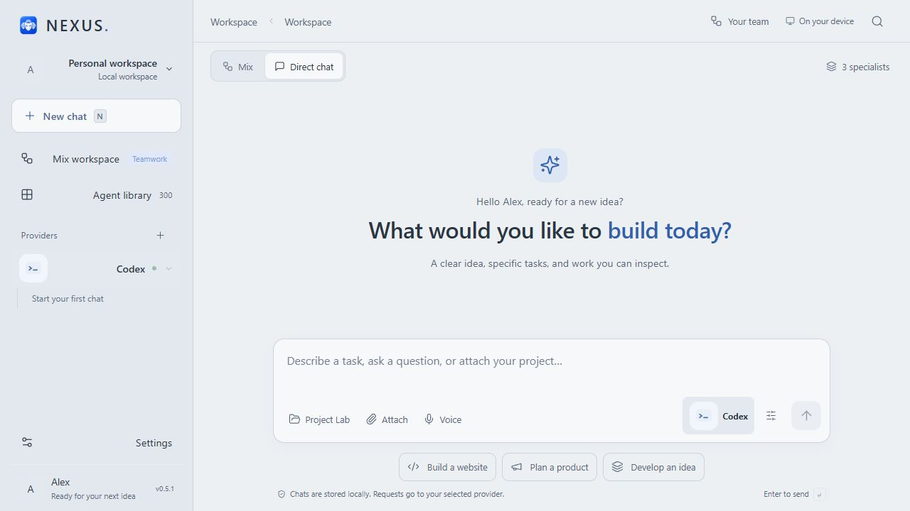
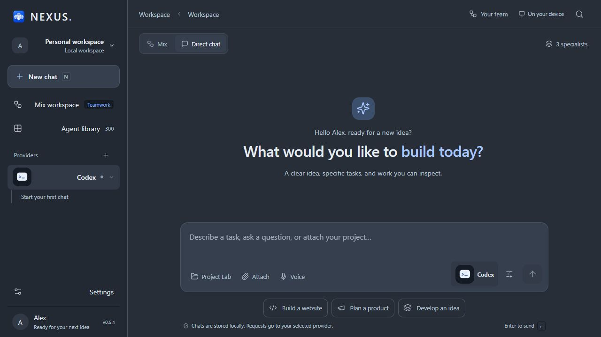

  
  <h1>NEXUS</h1>
  <h3>Your AI tools. One organized workspace.</h3>
  
Plan, build, and review with your AI providers and 300 specialist roles.

  
<strong><a href="https://github.com/Ahmed-Khalil-Mohamed/NEXUS/releases/tag/v0.5.1">Download for Windows</a></strong> · <a href="docs/USER-GUIDE.md">User guide</a> · <a href="docs/FAQ.md">FAQ</a> · <a href="https://github.com/Ahmed-Khalil-Mohamed/NEXUS/issues">Report an issue</a>

  
Windows x64 · English & Arabic · Light & dark · Proprietary software

<picture>
  <source media="(prefers-color-scheme: dark)" srcset="assets/workspace-dark.png">
  
</picture>

NEXUS is a Windows desktop application that brings supported AI tools, project context, conversations, and a specialist library together. Start a direct conversation or use **Mix** to coordinate a team through NEXUS Manager. Track assignments, reported tool activity, time, usage, and generated files in one place.

## Download & start

**[Download the Windows installer](https://github.com/Ahmed-Khalil-Mohamed/NEXUS/releases/download/v0.5.1/NEXUS-Setup-0.5.1.exe)**

| File | Choose it when… |
| --- | --- |
| [NEXUS-Setup-0.5.1.exe](https://github.com/Ahmed-Khalil-Mohamed/NEXUS/releases/download/v0.5.1/NEXUS-Setup-0.5.1.exe) | You want guided installation and Windows shortcuts. Recommended for regular use. |
| [NEXUS-0.5.1-Windows.exe](https://github.com/Ahmed-Khalil-Mohamed/NEXUS/releases/download/v0.5.1/NEXUS-0.5.1-Windows.exe) | You want to run without installing. Settings still live in your Windows user profile. |
| [SHA256SUMS.txt](https://github.com/Ahmed-Khalil-Mohamed/NEXUS/releases/download/v0.5.1/SHA256SUMS.txt) | You want to verify the downloaded files. |

1. Download and open an **EXE** from [Releases](https://github.com/Ahmed-Khalil-Mohamed/NEXUS/releases).
2. Wait for the startup banner, displayed for about 30 seconds.
3. Enter your name once, discover your tools, and select supported providers.
4. Start a chat, choose a project folder, or assemble a Mix team.
5. Use Settings for language, theme, memory, and provider preferences.

Node.js is bundled. A supported AI provider account or local model service is required. Provider subscriptions, usage limits, and charges still apply.

This Windows x64 preview has been tested on the development Windows machine; compatibility with every configuration is not certified. No ARM64, macOS, or Linux package is provided. The executables are unsigned: verify the source and checksum without disabling Windows security.

GitHub automatically adds **Source code (zip / tar.gz)** downloads. Here they contain this repository's documentation and images, **not the application's development source**. Choose an **EXE** to run NEXUS.

## What can you do with NEXUS?

| What you want to do | What NEXUS provides |
| --- | --- |
| Talk to your AI tools | Supported provider connections, Markdown responses, and saved conversations. |
| Coordinate a project | A fixed Manager plans assignments and dependencies, specialists contribute, and review/repair stages follow. |
| Choose expertise | 300 editable roles across planning, engineering, design, marketing, quality, and other disciplines. |
| Work on existing files | Project Lab reads a selected folder within documented limits and sends context with your request. |
| Understand the result | Reported tool activity, duration, token usage when available, and generated-file summaries. |
| Apply changes | An explicit Apply action, original-file conflict checks, and local backups. |
| Add context | Text/code, text-based PDF, DOCX, supported images, sampled video frames, and locally transcribed audio. |
| Personalize your workspace | English or Arabic, light or dark, and saved onboarding/preferences. |

## Your providers, connected

Built-in execution adapters cover **Codex CLI, Claude Code CLI, Ollama, and LM Studio**. Authenticate through each CLI's own tools or start your local model service, then run a connection check in Settings.

Discovery also finds other installed tools and candidate agent files. **Detected does not mean connected:** execution requires a compatible CLI or API. Supported custom local connectors can be configured. No model weights or paid AI subscriptions are included.

## How Mix works

**Your brief → Manager plan → Specialist assignments → Integration → Review → Repair when needed → Final report**

Each specialist receives a task, deliverables, acceptance criteria, and dependencies. The 300 roles are instruction definitions working through selected providers, not 300 bundled AI models. The Manager remains part of the workflow.

All 300 roles can participate, in scheduled batches with 1–4 concurrent calls depending on settings and available memory. Bigger teams consume more requests and take longer. Failed specialists stop the run; remaining issues after the repair pass are reported for follow-up. [Read the workflow guide](docs/USER-GUIDE.md#mix-and-the-specialist-library).

## See the workspace

### A calm starting point

### A darker workspace, with the same layout

Unaltered 0.5.1 interface captures from an isolated demonstration profile. Alex is an example name. These show the shared desktop interface through its local preview; no AI response or performance result is fabricated. [Image details](assets/README.md).

## Privacy & control

Settings, chats, and project records are stored locally. Sending a request shares relevant messages, selected project content, and supported attachments with your chosen provider. Its data policy applies. Local storage is not encrypted by NEXUS.

Discovery enumerates paths; it does not read all personal documents or bypass Windows permissions. Project reads are bounded. Generated changes require Apply. NEXUS does not automatically run generated code or install its dependencies. [Privacy details](docs/PRIVACY.md).

## Release notes & support

Version 0.5.1 refines chat spacing, combines project/attachment controls in the composer, improves light/dark colors, and makes completed-run reports easier to scan. See [CHANGELOG](CHANGELOG.md), the [user guide](docs/USER-GUIDE.md), and [FAQ](docs/FAQ.md).

[Report issues](https://github.com/Ahmed-Khalil-Mohamed/NEXUS/issues) with the NEXUS version, Windows version, selected provider, and reproduction steps. Remove tokens, private prompts, personal paths, and project content before posting.

## License & credits

NEXUS is **proprietary, closed-source software**. You may download, install, and use its official binaries under [NOTICE.txt](NOTICE.txt). This public repository contains documentation and images only. Development source is maintained separately in a private repository.

Third-party libraries and fonts retain their licenses; see [THIRD-PARTY-NOTICES.txt](THIRD-PARTY-NOTICES.txt) and the Electron/Chromium notices included with the application. Provider names belong to their owners. NEXUS is independent and is not endorsed by the referenced providers.
