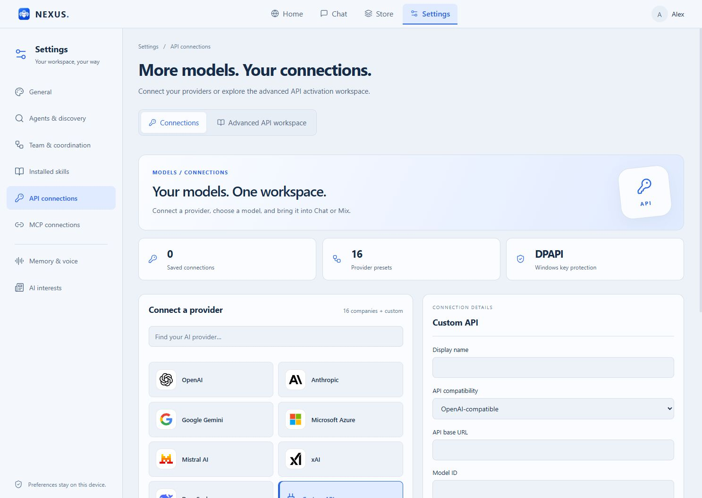
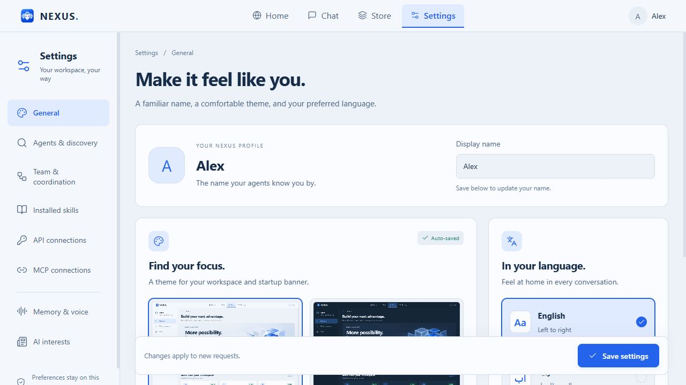
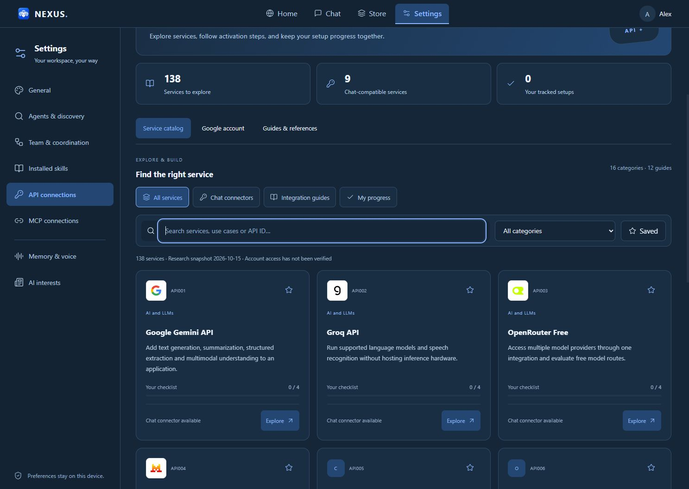

# NEXUS — Your AI workspace for Windows

Bring conversations, projects, specialist teams and connected tools into one desktop app.

**Version 0.6.13 · Windows x64 · English & Arabic · Light & dark themes**

[Download installer](https://github.com/Ahmed-Khalil-Mohamed/NEXUS/releases/download/v0.6.13/NEXUS-Setup-0.6.13.exe) · [Portable EXE](https://github.com/Ahmed-Khalil-Mohamed/NEXUS/releases/download/v0.6.13/NEXUS-0.6.13-Windows.exe) · [What's new](docs/RELEASE-0.6.13.md) · [User guide](docs/USER-GUIDE.md)

## One workspace, more possibilities

| Workspace | What you can do |
| --- | --- |
| **Home** | Resume conversations, review local activity, follow selected AI companies and compare model pricing snapshots. |
| **Chat Studio** | Select an available agent and model, attach project context, personalize instructions and inspect responses, reported tools and file changes. |
| **Mix** | Let NEXUS Manager assign specialist work, coordinate stages and bring implementation and review together. |
| **Store** | Explore workspace tools, compatible skills, MCP connections, public local models and your installed library. |
| **Settings** | Manage discovery, team routing, skills, API connections, MCP permissions, appearance, language, memory and voice. |

## Chat Studio & Mix

Your conversations have their own history, composer and agent/model selection. The execution panel separates **Workflow**, **Activity** and **Files**. Select a Mix stage to inspect its assignment, instructions and available output.

The library includes **300 editable specialist roles**. These are instructions executed through your configured providers, not 300 bundled models. NEXUS Manager coordinates work, and eligible providers can be routed by capability. Work runs in scheduled batches, subject to concurrency settings and provider limits.

## A redesigned Store

Browse Discover, Workspace tools, Skills, MCP connections, Local models and Your library. Review a skill before installing it into a supported agent's location. Explore public compatible GGUF models from Hugging Face and run supported downloads through Ollama.

## API connections — setup with context

- **16 provider presets**, plus configurable compatible endpoints.
- **138 researched services in 16 categories**, included inside Advanced API settings.
- **12 handbook chapters**, activation checklists, favorites, account requirements, monitoring notes and official references.
- **9 explicit catalog-to-chat mappings**; remaining profiles are integration guides, not automatically callable chat tools.
- Search saved connections, edit without creating duplicates, and inspect session-specific connection feedback.

[Full 138-service catalog](docs/API-CATALOG.md) · [API setup and provider presets](docs/API-GUIDE.md) · [Google account setup](docs/GOOGLE-API-SETUP.md) · [Catalog JSON](docs/api-catalog.json)

The research snapshot is dated **15 October 2026**. It is not a live price, quota or account-eligibility feed. Google sign-in needs an app-specific Desktop OAuth Client ID; it does not activate third-party APIs or replace their authorization requirements.

## MCP tools, with visible permissions

Manage saved servers separately from their configuration. Search servers and discovered tools, choose individual permissions, and distinguish saved servers from enabled connections and available tools. New servers start disabled. HTTP and stdio configuration have separate validation.

[Read the MCP guide](docs/MCP-GUIDE.md)

## A workspace that feels like yours

A clearer settings navigation, visual theme previews, profile settings and language controls. Chat preferences include goals, response detail, tone, instructions, suggestions and tool access.

*Actual interface screenshots using an isolated demonstration workspace. Conversation results and activity are demo data; no paid AI request was made for these screenshots.*

## Install or update

1. Download the **Setup EXE** to install, or the **Windows EXE** for portable use.
2. Close NEXUS before updating. Back up your workspace if it contains important work.
3. Launch the EXE. Existing local onboarding and preferences are retained; connect an authorized provider or supported local runtime.
4. Use the release's **SHA256SUMS.txt** to verify your download.

Both editions use `%APPDATA%/NEXUS/workspace`. Windows x64 is required. Executables are currently unsigned.

## What to expect

- Discovery does not guarantee that every detected application supports programmatic execution.
- Reported tokens, model identity and tool activity depend on the provider; unavailable values remain unknown.
- Project Lab reads bounded context. Proposed changes require Apply and conflict checks; generated code and dependencies are not automatically executed or installed.
- Voice requires a configured local transcription service. Video import uses three sampled frames.
- Local downloads require compatible hardware, model licenses and a supported Ollama runtime. Gated/private/split model downloads are not supported by this flow.
- MCP OAuth is not supported in this build. Review each tool's permissions and data handling.

## Documentation & support

[User guide](docs/USER-GUIDE.md) · [API guide](docs/API-GUIDE.md) · [MCP guide](docs/MCP-GUIDE.md) · [FAQ](docs/FAQ.md) · [Privacy](docs/PRIVACY.md) · [Changelog](CHANGELOG.md) · [Report an issue](https://github.com/Ahmed-Khalil-Mohamed/NEXUS/issues/new/choose) · [Share NEXUS](docs/LAUNCH-KIT.md)

## Distribution & credits

NEXUS is proprietary software. This public repository contains **documentation and images**; release assets contain Windows executables. Application source is maintained separately in a private repository. GitHub's automatic “Source code” archives contain only this distribution repository, not the application source tree. Private hosting does not prevent extraction or reverse engineering of distributed binaries.

See [NOTICE.txt](NOTICE.txt) and [THIRD-PARTY-NOTICES.txt](THIRD-PARTY-NOTICES.txt). Third-party names and logos belong to their owners; NEXUS is not endorsed by the referenced providers.
