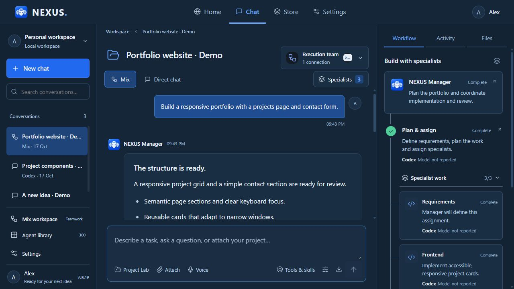
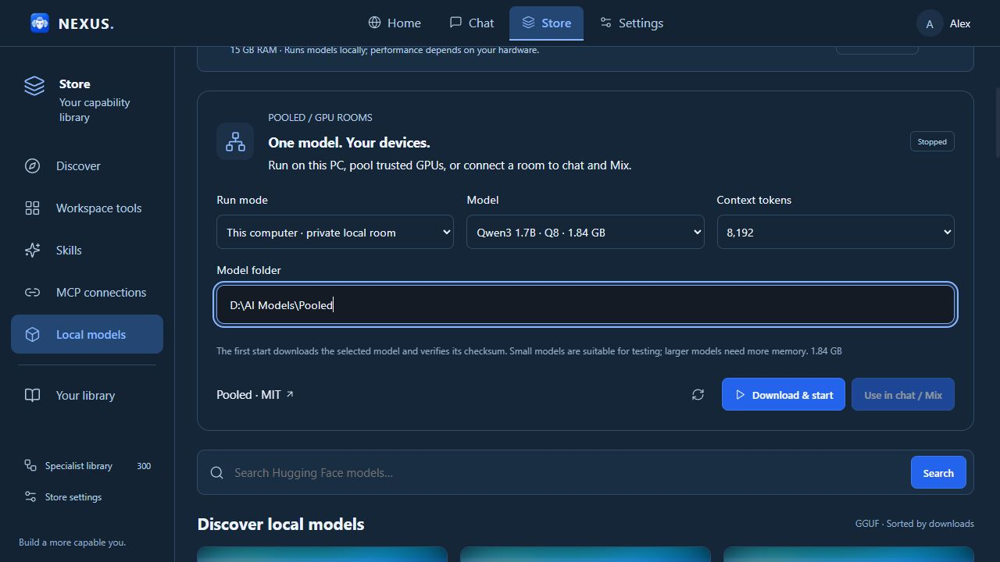
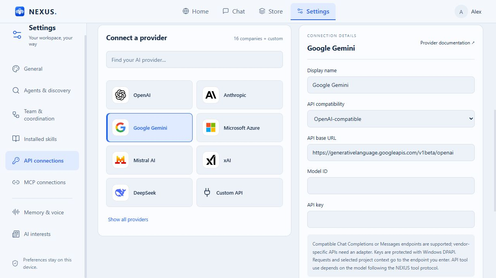

# NEXUS 0.6.19 — Local GPU inference. Connected tools. Clearer execution.

This release combines the interface, API workspace and runtime improvements since the previous public binary release, 0.6.6.

**[Windows installer](https://github.com/Ahmed-Khalil-Mohamed/NEXUS/releases/download/v0.6.19/NEXUS-Setup-0.6.19.exe)** · **[Portable EXE](https://github.com/Ahmed-Khalil-Mohamed/NEXUS/releases/download/v0.6.19/NEXUS-0.6.19-Windows.exe)**

## Pooled GPU runtime

Run a supported model on your Windows GPU, host a room for trusted devices, or connect an existing Pooled room to Chat and Mix. Store → Local models includes model selection, context limits, download/start controls, live runtime status and a stop button that releases GPU resources. Pooled CLI 2.0.1 and its native runtime are bundled; model weights download separately.

Pooled distributes model layers across devices; it does not make a small model as capable as a larger one. The local API bridge requires authentication. Multi-device support is included but was not tested across multiple physical computers in this release. [Setup and limitations](POOLED-GUIDE.md).

## Chat, projects and Mix

- Improved message rendering, composer layout, response details and file outcomes.
- Clearer selection of specialist roles, including the full 300-role library. NEXUS Manager coordinates work; roles execute through selected providers in bounded batches.
- Improved project read/write delivery, tool execution evidence and run accounting. Review generated files and actual check results; a model's summary alone is not proof that tests passed.
- Refined first-run loading, company selection, discovery and API introduction, with English/Arabic and light/dark support.
- Refreshed Home, Store and Settings, with usage dashboards, model comparisons, skills and MCP management.

## APIs you can connect and services you can explore

**16 chat-provider presets**, custom compatible endpoints, and **138 researched API services across 16 categories**. Advanced API includes activation steps, credential requirements, official references and progress tracking. Nine catalog entries map directly to chat presets; other services require their own integration or an appropriate MCP server.

[API guide](API-GUIDE.md) · [All 138 services](API-CATALOG.md) · [Detailed activation reference](API-ACTIVATION.md) · [Machine-readable catalog](api-catalog.json) · [Google setup](GOOGLE-API-SETUP.md) · [MCP guide](MCP-GUIDE.md)

No API keys or provider credits are included. Google identity does not replace provider authorization. Catalog research is dated 15 October 2026; this update does not claim to re-verify every vendor's current pricing or eligibility.

## Validation and practical limits

- 99 automated tests passed; eight focused runtime tests passed again after the final native-runtime change.
- Windows application startup and packaged GPU inference were tested.
- A local 1.7B model created a JavaScript file through NEXUS; a separate chat invoked an actual NEXUS tool. Native Pooled function calling was also checked.
- Earlier runtime checks covered real Codex project execution, an MCP call, skill context, a two-specialist Mix run and local-model/skill downloads.
- Small local models can ignore instructions or invent results. Use larger capable models for demanding development, and verify their output.
- Executables are unsigned. Installer and portable files were built; the final installer installation flow was not exercised.

## Install or update

Close NEXUS, download the Setup EXE or portable Windows EXE, and compare its SHA-256 with the release checksum file. Existing default workspace data is retained. Model downloads need additional disk space and compatible hardware.

The public repository contains documentation and images. Application source remains in a separate private repository. Automatic GitHub source archives contain this documentation repository only.

*New English screenshots were captured from the current interface in an isolated demonstration workspace. Demo messages and run counts illustrate the layout; they are not performance benchmarks or paid-provider results.*
