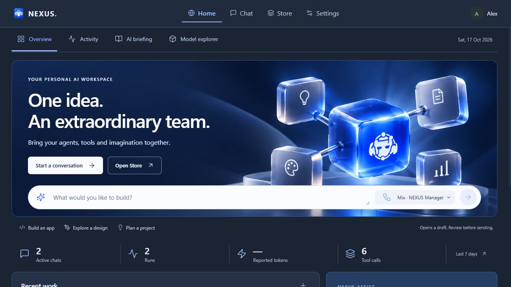
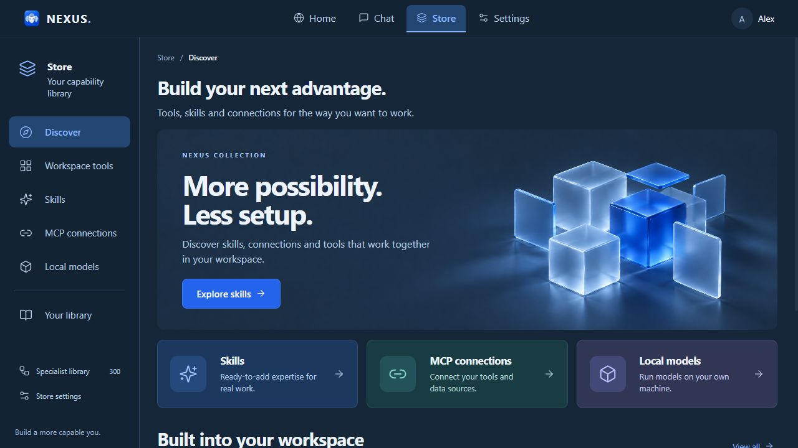
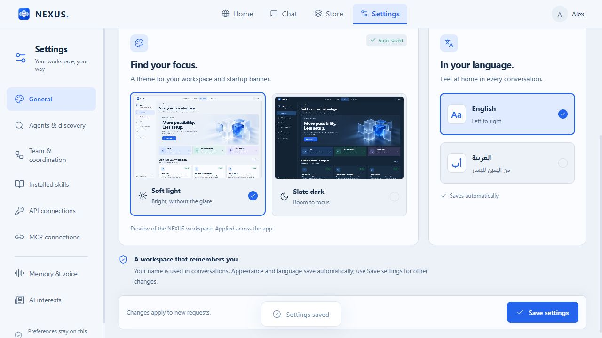
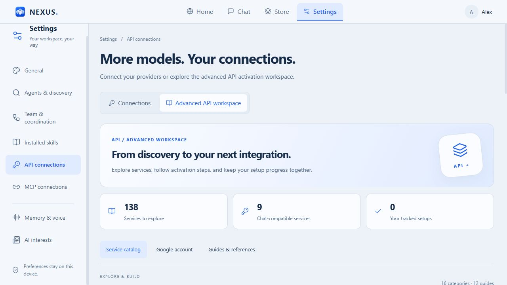
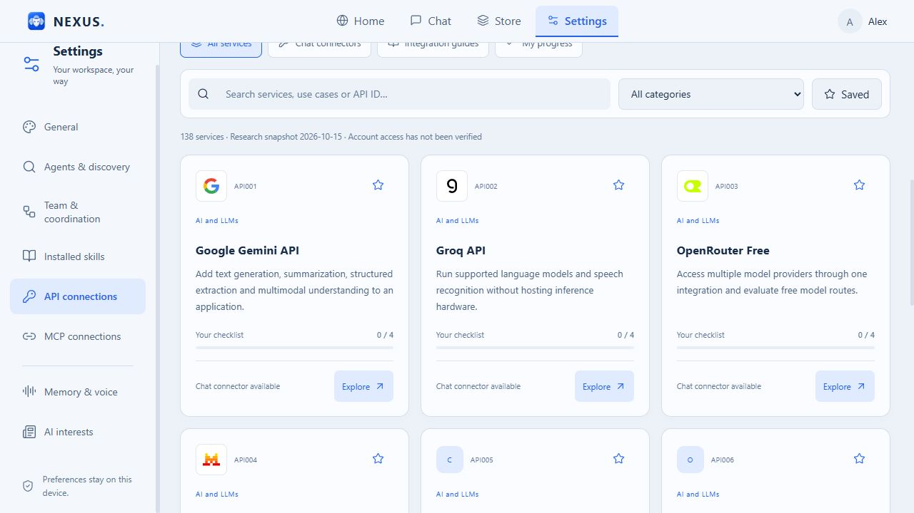

# NEXUS 0.6.19 — Interface gallery

New English screenshots captured from version 0.6.19 in an isolated demonstration workspace. Messages and run counts are demo data; these images are not performance benchmarks.

## Home and recent work

## Chat Studio and Mix

## Store

## Pooled local GPU setup

## Settings

## API connections

## Advanced API catalog

## API service cards

