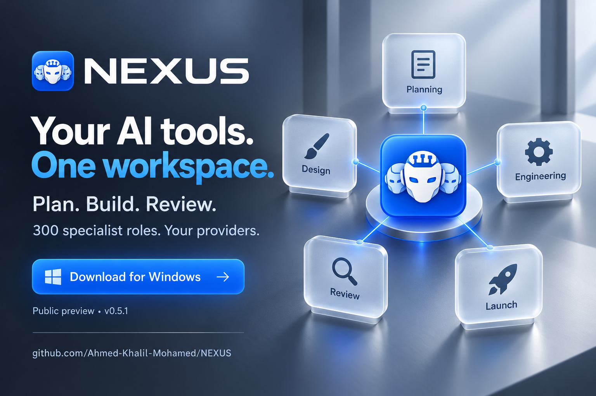

# NEXUS launch kit

English copy and artwork for introducing the Windows public preview. Share the official download link rather than re-uploading executables to other services.

## Campaign image

[Download the launch artwork](../assets/nexus-launch.png)

Conceptual campaign artwork, not an app screenshot. [Actual English screenshots and provenance](../assets/README.md).

## Full post

Meet NEXUS for Windows — your AI tools, one workspace.

Connect supported providers such as Codex CLI, Claude Code CLI, Ollama, and LM Studio. Start a direct chat, bring in an existing project folder, or use Mix to coordinate specialist roles through NEXUS Manager.

The library includes 300 roles for planning, engineering, design, review, marketing, and more. They work through your selected providers in batches. Review reported activity and generated files before applying changes.

English and Arabic. Light and dark. Saved conversations and preferences.

Download the Windows installer or portable EXE:
https://github.com/Ahmed-Khalil-Mohamed/NEXUS/releases/tag/v0.5.1

Version 0.5.1 is an unsigned public preview. A supported AI provider account or local model service is required; provider usage charges and policies apply. NEXUS is proprietary software.

Try it, share your workflow, and help shape the next version.

## Short post

NEXUS brings your AI tools into one Windows workspace. Direct chat, project context, and Mix coordination with 300 specialist roles. English/Arabic, light/dark. Public preview: https://github.com/Ahmed-Khalil-Mohamed/NEXUS/releases/tag/v0.5.1

## Suggested hashtags

`#NEXUS #AIAgents #DeveloperTools #Windows #LocalAI`

## Links

- [Project page](https://github.com/Ahmed-Khalil-Mohamed/NEXUS)
- [Windows downloads](https://github.com/Ahmed-Khalil-Mohamed/NEXUS/releases/tag/v0.5.1)
- [User guide](USER-GUIDE.md)
- [Discussions](https://github.com/Ahmed-Khalil-Mohamed/NEXUS/discussions)

Do not add invented endorsements, popularity statistics, guaranteed results, or claims that the 300 roles are bundled models. Campaign copy does not imply unrestricted access to private source.
