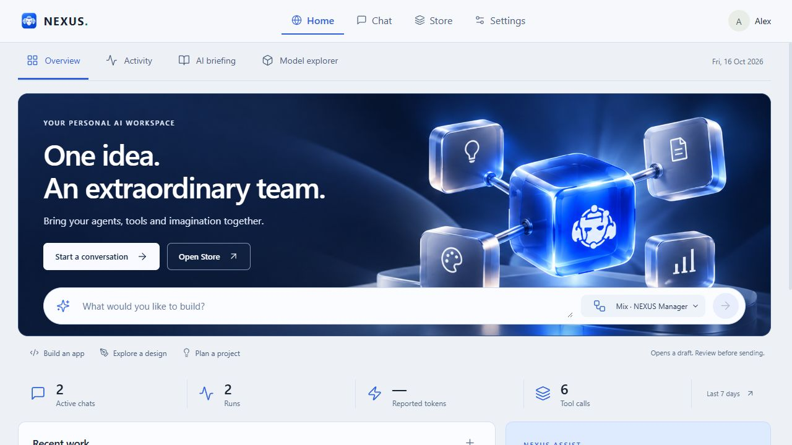
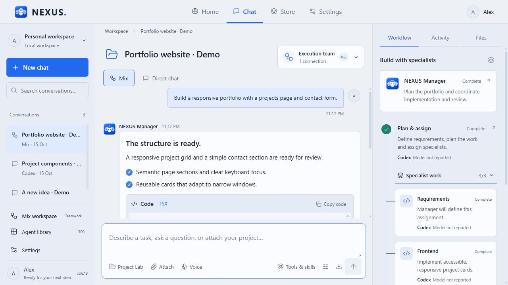
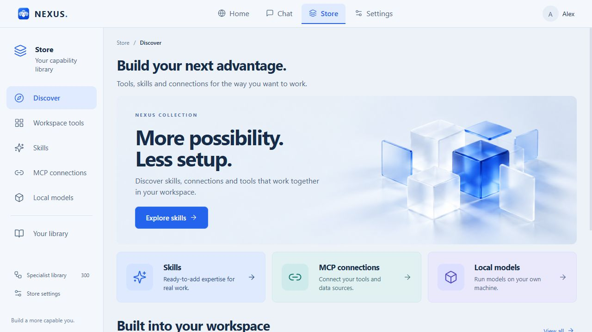
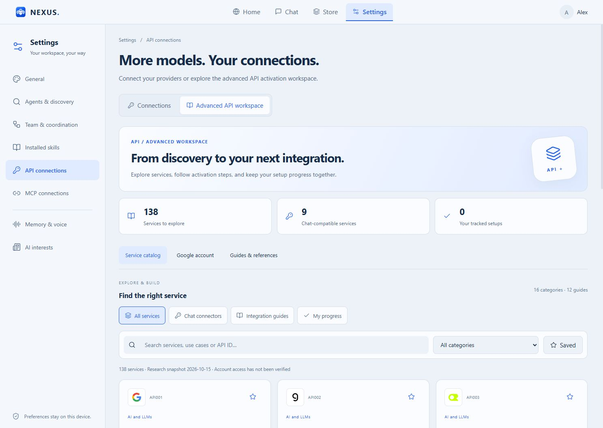

# NEXUS 0.6.13 — A more connected workspace

All changes since the public 0.6.6 release, together in one Windows update: a redesigned Home, Chat Studio, Store and Settings, with expanded API research and clearer MCP management.

## Download

[Windows installer](https://github.com/Ahmed-Khalil-Mohamed/NEXUS/releases/download/v0.6.13/NEXUS-Setup-0.6.13.exe) · [Portable EXE](https://github.com/Ahmed-Khalil-Mohamed/NEXUS/releases/download/v0.6.13/NEXUS-0.6.13-Windows.exe)

## What's new

| Area | Changes |
| --- | --- |
| Home | New overview, recent work, editable prompt starters, activity dashboard, AI briefing and model comparison with aligned pricing rows. |
| Chat Studio | Conversation search, top agent/model selection, project and media composer, formatted code with copy controls, and Workflow / Activity / Files views. |
| Mix | Persistent NEXUS Manager, stage progress, specialist assignments and inspectable instructions and outputs. |
| Store | Six sections: Discover, Workspace tools, Skills, MCP connections, Local models and Your library. |
| Settings | Eight organized areas, visual light/dark previews, profile controls and English/Arabic layouts. |
| API | 16 provider presets, saved-connection search, stable IDs when editing, and session-specific test feedback. |
| Advanced API | 138 service profiles, 16 categories, 12 handbook chapters, activation checklists and filters for chat connectors, integration guides and tracked progress. |
| MCP | Search servers and tools, inspect permissions, separate saved/enabled/tool counts, and validate transport-specific configuration. |
| Workspace intelligence | Capability context for agents, read-only workspace/project/research/usage tools, editable suggestions and per-chat preferences. |
| Reliability | API drafts and filters survive mode switches; repeated saves update records instead of duplicating them; missing generated artifacts return a not-found response. |

## See the update

Actual interface screenshots with isolated demonstration data.

## API coverage

The full [138-service catalog](API-CATALOG.md) is included in the application. [All 16 chat presets](API-GUIDE.md) and [MCP setup](MCP-GUIDE.md) are documented separately. Nine handbook entries map directly to chat adapters; other records provide integration guidance. This is a curated research catalog, not a claim to support every API worldwide.

Google identity wiring is included, but a developer-owned Desktop OAuth Client ID is still required. See [Google setup](GOOGLE-API-SETUP.md). Sign-in does not automatically grant third-party API access.

## Validation

- Production TypeScript/Vite build completed.
- **83 automated tests passed, 0 failed.**
- Isolated UI checks covered API/MCP record updates, draft retention, handbook progress, transport validation and responsive English/Arabic layouts.
- Packaged UI files matched the build. Portable EXE smoke testing confirmed the application window and frameless splash loaded.
- Release binaries are accompanied by SHA-256 checksums and third-party notices.

No paid model request or real vendor credential was used for these checks. Real Google OAuth remains untested without a configured Client ID. The interactive installer was packaged but not installed during validation. Executables are unsigned; an existing bundle-size build warning remains.

## Updating

Close NEXUS, back up important workspace data, then use the installer or portable EXE. Both use the existing local workspace. Download EXE assets below; GitHub's automatic source archives contain this public documentation repository only.
